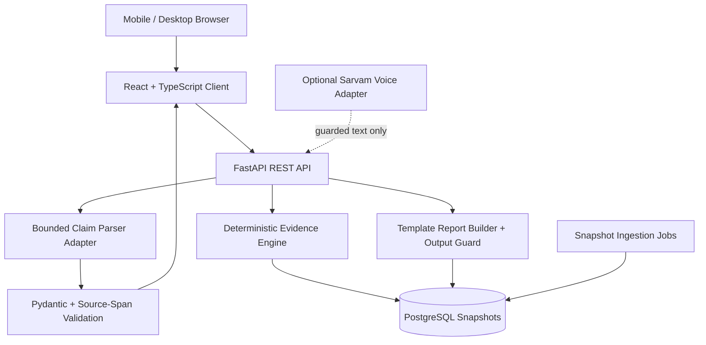

# Tip Autopsy — Technical Architecture

**Document status:** Draft for architecture review  
**Blueprint version:** 1.0  
**Architecture principle:** Deterministic evidence engine, bounded AI parsing, zero user-account persistence.

---

## 1. Architecture Summary

Tip Autopsy is a TypeScript React web client backed by a Python FastAPI service and PostgreSQL. The client is mobile-first and communicates with the backend through versioned JSON REST endpoints. Historical market, surveillance, SEBI-register, and curated tip data are loaded as dated snapshots. The backend computes the five market/lateness checks, benchmark-adjusted creator statistics, and facts-card content deterministically.

A language model is isolated behind a parser adapter and may only transform unstructured tip text into a validated Claim Ledger with source spans. It cannot provide market data, decide risk statuses, calculate track records, or write facts-card narrative. If parsing is unavailable, the structured influencer + stock path remains fully usable.

### 1.1 Selected stack

The source specification permits React + Tailwind, FastAPI or Express, PostgreSQL, a bounded LLM, Sarvam voice, and scheduled snapshot ingestion. This blueprint makes the following concrete selections for speed and maintainability:

| Layer | Selected technology | Reason for selection |
|---|---|---|
| Frontend | React, TypeScript, Vite | Fast feedback loop, component ecosystem, static deployment, and type-safe API integration. |
| Styling and UI | Tailwind CSS with accessible Radix/shadcn-style primitives | Rapid, consistent responsive UI without building every primitive from scratch. |
| Client routing | React Router | Clear step-based user flow and shareable routes without server rendering requirements. |
| Server-state | TanStack Query | Request caching, retries, loading/error states, and invalidation for read-heavy evidence views. |
| Local state | React Context + `useReducer` | Keeps transient tip input, current analysis, selected chart marker, and Pause & Plan responses in memory only. |
| Charting | Recharts with a custom marker interaction layer | Suitable for interactive price/volume charts and accessible tooltip/detail behavior. |
| Backend | Python 3.12+ and FastAPI | Typed REST contracts, quick development, and a natural fit for statistical and data-processing modules. |
| Validation | Pydantic v2 | Strict request/response schemas and parser-output validation. |
| ORM and migrations | SQLAlchemy 2 + Alembic | Relational persistence and explicit, reviewable schema changes. |
| Database | PostgreSQL | Relational joins across creators, tips, stocks, dates, and snapshots; reliable constraints and indexes. |
| Statistical/data tools | NumPy, pandas, SciPy | Reproducible calculations, historical data processing, and Beta distribution quantiles. |
| Backend tests | pytest | Fast unit and integration testing of deterministic logic and API contracts. |
| Frontend tests | Vitest + React Testing Library; Playwright for E2E | Component, behavior, and complete user-flow coverage. |
| Frontend hosting | Netlify | Straightforward static React deployment and preview deploys. |
| Backend hosting | Render web service | Simple FastAPI deployment with environment-managed secrets and logs. |
| Production database | Render PostgreSQL | Keeps the initial deployment topology small and avoids introducing a separate database operator. |
| Optional voice | Sarvam Voice API | Matches the product specification's optional Hindi/Kannada/English readout. |

Use a single repository with separate `frontend/` and `backend/` workspaces. Do not add Redis, a message broker, microservices, or Kubernetes for Version 1; none is needed for the expected scale or demo workflow.

### 1.2 High-level component view



### 1.3 Request lifecycle

1. The browser submits pasted tip text to the parse endpoint or retrieves an influencer/stock through structured lookup.
2. The parser adapter returns a proposed Claim Ledger. The backend validates its schema, normalizes entities, checks source spans against the original text, and marks unsupported or absent fields `Not stated`.
3. The browser requests dated evidence. The backend loads the relevant snapshot versions and calculates every check using deterministic Python modules.
4. The report builder assembles facts-card sentences from approved templates and verified values.
5. The Output Guard validates every system-authored sentence. If unsafe content is found, the report is blocked and a safe fallback is returned.
6. The browser renders provenance, status labels, and the mandatory disclaimer. User-entered text and Pause & Plan answers remain in active client memory and are not persisted.

## 2. Repository and Module Boundaries

Recommended repository layout (a target structure for implementation, not files created by this blueprint):

```text
/
├── frontend/
│   ├── src/
│   │   ├── app/              # Router, providers, application shell
│   │   ├── components/       # Reusable UI primitives
│   │   ├── features/
│   │   │   ├── input/
│   │   │   ├── claim-ledger/
│   │   │   ├── evidence/
│   │   │   ├── time-machine/
│   │   │   ├── facts-card/
│   │   │   └── pause-plan/
│   │   ├── lib/              # API client, formatters, shared helpers
│   │   └── types/            # API and domain types
│   └── ...
├── backend/
│   ├── app/
│   │   ├── api/              # FastAPI routers and dependency wiring
│   │   ├── core/             # Settings, logging, error types
│   │   ├── db/               # SQLAlchemy models, session, migrations
│   │   ├── domain/
│   │   │   ├── claims/       # Claim Ledger schema and normalization
│   │   │   ├── disclosure/   # Disclosure classifier
│   │   │   ├── hype/         # Phrase detection
│   │   │   ├── sebi/         # Register matching
│   │   │   ├── market_checks/# Five deterministic checks
│   │   │   ├── track_record/ # Benchmark adjustment and Beta-Binomial
│   │   │   └── output_guard/ # Templates, guard, safe fallback
│   │   ├── integrations/     # LLM and optional Sarvam adapters
│   │   ├── ingestion/        # Snapshot loaders and validation
│   │   └── main.py
│   ├── tests/
│   └── ...
├── docs/                     # Approved methodology and data-source notes
└── TASKS.md / PRD.md / ARCHITECTURE.md / AGENTS.md
```

Keep calculations independent from FastAPI route handlers. Route handlers validate requests and orchestrate domain services; they must not contain threshold logic or statistical formulas.

## 3. Data Architecture

### 3.1 Persistence principles

Persist curated reference data and dated public/synthetic datasets. Do not persist end-user profiles, accounts, portfolios, raw pasted tips, Pause & Plan answers, or user-level analysis history.

A user's pasted text is transient input. The parser endpoint may forward it to the configured LLM provider under the provider's data-handling terms, but the application must not write it to PostgreSQL, analytics events, traces, exception messages, or ordinary logs. Do not send raw pasted text to third-party analytics.

Publicly sourced creator names/handles in the curated tip corpus are dataset content, not end-user profile data; still minimize retained fields and document source/usage rights.

### 3.2 Relational entities

The following tables extend the core entities in the source specification with provenance and operational fields needed for repeatable production behavior. The Nifty 50 benchmark series is modelled explicitly so creator outcomes can be reproduced without treating an index as an ordinary stock.

#### `data_snapshot`

| Field | Type / constraint | Purpose |
|---|---|---|
| `id` | UUID primary key | Identifies one imported dataset snapshot. |
| `dataset_key` | text, indexed | Domain such as `nse_prices`, `bse_prices`, `sebi_register`, `surveillance`, or `market_cap`. |
| `source_name` | text | Human-readable source/provider. |
| `source_url` | text, nullable | Original source location when available. |
| `as_of_date` | date | Date represented by the dataset. |
| `retrieved_at` | timestamptz | Import time. |
| `data_label` | enum: `REAL`, `SYNTHETIC`, `MIXED` | Provenance label. |
| `version` | text | Version of the import or source format. |
| `checksum` | text | Detects accidental replacement or corruption. |
| `row_count` | integer | Imported record count. |
| `validation_status` | enum | `VALID`, `PARTIAL`, or `REJECTED`. |
| `notes` | text, nullable | Limitations, licensing notes, or import warnings. |

#### `influencer`

| Field | Type / constraint | Purpose |
|---|---|---|
| `id` | UUID primary key | Internal creator identifier. |
| `name` | text | Display name from curated tip records. |
| `handle` | text, nullable | Public platform handle when permitted. |
| `normalized_name` | text, indexed | Conservative name matching. |
| `sebi_registration_no` | text, nullable | Optional curated registration reference; not authoritative without snapshot matching. |
| `created_at` | timestamptz | Row creation time. |

#### `sebi_register_entry`

| Field | Type / constraint | Purpose |
|---|---|---|
| `id` | UUID primary key | Register entry identifier. |
| `snapshot_id` | UUID foreign key to `data_snapshot` | Exact register snapshot used. |
| `name` | text | Registered legal/display name from source. |
| `normalized_name` | text, indexed | Matching support. |
| `registration_no` | text, indexed | Register identifier. |
| `category` | text | Source category. |
| `snapshot_date` | date | Dated validity of the imported register. |

Use a uniqueness constraint on (`snapshot_id`, `registration_no`). Never infer registration solely from fuzzy name similarity. Ambiguous matches return `Unclear`.

#### `stock`

| Field | Type / constraint | Purpose |
|---|---|---|
| `ticker` | text primary key | Canonical exchange ticker. |
| `company_name` | text | Company name. |
| `exchange` | enum: `NSE`, `BSE` | Exchange. |
| `circuit_band` | text, nullable | Most recent imported band; dated surveillance snapshots remain authoritative for historical queries. |
| `created_at` | timestamptz | Row creation time. |

#### `price_history`

| Field | Type / constraint | Purpose |
|---|---|---|
| `id` | UUID primary key | Row identifier. |
| `ticker` | text foreign key to `stock` | Security. |
| `trading_date` | date | Trading session. |
| `close` | numeric(18, 4) | Closing price. |
| `volume` | bigint | Traded volume. |
| `snapshot_id` | UUID foreign key to `data_snapshot` | Exact source snapshot. |

Unique key: (`ticker`, `trading_date`, `snapshot_id`). Index (`ticker`, `trading_date`). Do not overwrite historical rows without retaining snapshot provenance.

#### `stock_info`

| Field | Type / constraint | Purpose |
|---|---|---|
| `id` | UUID primary key | Row identifier. |
| `ticker` | text foreign key to `stock` | Security. |
| `market_cap` | numeric(22, 2), nullable | Dated market capitalization. |
| `size_band` | enum: `LARGE`, `MID`, `SMALL`, `MICRO`, nullable | Versioned classification result. |
| `circuit_band` | text, nullable | Circuit-band value represented by this snapshot. |
| `snapshot_id` | UUID foreign key to `data_snapshot` | Exact source snapshot. |
| `classification_version` | text | Methodology version for size bands. |

Unique key: (`ticker`, `snapshot_id`). Do not classify when market cap, circuit-band evidence, or the applicable band methodology is missing.

#### `benchmark_history`

| Field | Type / constraint | Purpose |
|---|---|---|
| `id` | UUID primary key | Row identifier. |
| `benchmark_key` | text, indexed | Index identifier; Version 1 uses `NIFTY_50`. |
| `trading_date` | date | Trading session. |
| `close` | numeric(18, 4) | Official/verified index close. |
| `snapshot_id` | UUID foreign key to `data_snapshot` | Exact source snapshot. |

Unique key: (`benchmark_key`, `trading_date`, `snapshot_id`). Index (`benchmark_key`, `trading_date`). This dataset is required for benchmark-adjusted creator outcomes.

#### `surveillance_entry`

| Field | Type / constraint | Purpose |
|---|---|---|
| `id` | UUID primary key | Row identifier. |
| `ticker` | text foreign key to `stock` | Security. |
| `list_name` | enum/text | ASM, GSM, or another explicitly named exchange list. |
| `is_active` | boolean | Status represented by this snapshot. |
| `snapshot_id` | UUID foreign key to `data_snapshot` | Exact exchange snapshot. |
| `snapshot_date` | date | Snapshot date. |

#### `tip`

| Field | Type / constraint | Purpose |
|---|---|---|
| `id` | UUID primary key | Tip identifier. |
| `influencer_id` | UUID nullable foreign key to `influencer` | Creator when known. |
| `ticker` | text nullable foreign key to `stock` | Canonical security when resolved. |
| `tip_date` | date | Publication date. |
| `text` | text | Curated source tip text; only permitted public or team-authored corpus rows. |
| `direction` | enum/text nullable | Direction stated in the original tip. |
| `target_price` | numeric nullable | Extracted original claim, not an app recommendation. |
| `deadline` | date nullable | Stated resolution date. |
| `stop_loss` | numeric nullable | Stated original claim. |
| `extracted_claim_json` | JSONB | Curated/validated Claim Ledger. |
| `disclosure_grade` | enum: `CLEAR`, `VAGUE`, `NONE`, `UNKNOWN` | Evidence classification. |
| `source_url` | text nullable | Original source link, after URL validation. |
| `is_synthetic` | boolean | Compatibility flag for record-level labeling. |
| `snapshot_id` | UUID nullable foreign key | Dataset import that introduced the row. |
| `created_at` | timestamptz | Import time. |

Index (`influencer_id`, `ticker`, `tip_date`). For a production schema, `is_synthetic` must always be set explicitly; do not rely on a nullable default.

#### `calibration_case` (recommended for reproducible threshold calibration)

Store public enforcement-case references and the associated security/date window, source link, event classification, and calibration dataset version. Do not store unsupported allegations or label any creator as fraudulent. Keep the calibration set small and disclose its limitations.

#### `ingestion_run`

Store dataset key, start/end times, snapshot identifier, status, imported/rejected counts, validation summary, and a safe error summary. Do not store secrets or raw user text.

### 3.3 Database rules and indexes

- Use foreign keys and explicit enum/check constraints for statuses and data labels.
- Store all dates as dates when time-of-day is not meaningful; use timezone-aware timestamps for ingestion/audit times.
- Store market prices and market caps as decimals, never binary floating-point values in persistence.
- Index ticker/date history, creator/ticker/tip-date lookups, snapshot date/domain, and SEBI normalized-name/registration lookup.
- Keep imported snapshots immutable. A correction creates a new snapshot/version and preserves prior provenance.
- Use SQL migrations for every schema change. Avoid ad hoc production schema changes.
- Never add user accounts, user profiles, portfolios, saved tips, or raw-input history tables in Version 1.

## 4. Deterministic Domain Logic

### 4.1 Common check result contract

Each market check returns:

```json
{
  "check_id": "volume_spike",
  "status": "NEEDS_ATTENTION",
  "measured_value": 6.1,
  "unit": "x_average_volume",
  "as_of_date": "2026-11-19",
  "source_snapshot_id": "0f7e9f6d-2d5a-4f1d-9e3a-5c8b0e7a1101",
  "method_version": "volume-spike-v1",
  "explanation_key": "volume_spike_explanation"
}
```

The date shown in a report must come from the selected source snapshot, not from the browser clock. If any required input, date alignment, or methodology version is missing, return `COULD_NOT_VERIFY` with a reason code. Do not return a guessed numeric value.

### 4.2 Five checks

1. **Liquidity** — Compute daily traded value as `close × volume`, then calculate the average over the configured prior N valid trading sessions. Classify using a versioned threshold table calibrated against historical enforcement cases and a normal-stock set.
2. **Market cap** — Load the market-cap snapshot for the applicable as-of date and map it to Large/Mid/Small/Micro using versioned boundaries. The boundary source and effective date must be documented. If the boundary scheme or cap value is absent, return `COULD_NOT_VERIFY`.
3. **Volume spike** — Compare tip-date volume with average volume over the prior N valid sessions. Retain both ratio and, where calibrated, z-score. Use a versioned threshold table; never hard-code an unexplained cutoff.
4. **Pre-tip run-up** — Calculate the percentage change from the close five valid trading sessions before the tip to the close immediately preceding the tip. Display the exact date range and formula. Missing sessions return `COULD_NOT_VERIFY`.
5. **Surveillance / circuit band** — Look up dated ASM/GSM membership and applicable circuit-band snapshot. Return a clear yes/no status only when the relevant snapshot exists and covers the queried date; otherwise return `COULD_NOT_VERIFY`.

The initial lookback default for N may be 20 valid trading sessions, but it remains configuration and must be validated before release. Calibration tasks must compare precision and recall against a naive baseline (including a small-cap-only heuristic) and report confidence intervals.

### 4.3 Creator track record

For each historical tip that has a valid direction, tip date, stated deadline, and aligned market data:

- Use the first valid market close strictly after the tip publication date as the entry reference; when only a date (not a timestamp) is available, use the next valid trading session close to avoid assuming the tip was available before that day’s close.
- Compute the security return from that entry reference to the stated deadline close. Compute the Nifty 50 return over exactly the same interval.
- Compute directional excess return as:

  `directional_excess_return = direction_sign × (security_return - nifty_50_return)`

  where `direction_sign` is `+1` for a bullish/up claim and `-1` for a bearish/down claim.
- Classify positive directional excess return as a success and negative directional excess return as a failure. Exact ties and observations without valid date alignment are excluded from the binary denominator and reported as unresolved/excluded counts.
- Compute the creator posterior using a versioned Beta prior: `Beta(alpha_prior + successes, beta_prior + failures)`.
- Display the selected credible interval (95% default), resolved sample count, excluded count, benchmark methodology, and as-of date.
- Display `Not enough tips to judge` when fewer than 20 resolved tips are available (provisional MVP policy) or the credible interval does not clear the matched market baseline. The minimum sample count, prior, baseline cohort, and interval level are configuration values documented in the methodology.

Do not display an unadjusted creator leaderboard or imply that past outcomes predict future returns. The 20-tip floor is an initial conservative implementation policy and must be revisited during evaluation; it is not a claim contained in the source specification.

### 4.4 Claim Ledger and bounded language model

- The LLM adapter receives only the text required for parsing and a constrained extraction instruction.
- Its only allowed output is a schema-constrained object containing stock, direction, target price, deadline, stop-loss, and source-span offsets/quotes.
- Validate JSON with Pydantic. Reject invalid types, unsupported fields, out-of-range spans, or evidence quotes that do not match the original text.
- Normalize ticker candidates against the local stock catalogue. Do not accept a model-invented ticker as a verified security.
- Missing fields remain `Not stated`. Low-confidence or ambiguous fields are marked `Unclear` and require structured lookup or user correction.
- The parser must not return risk scores, market facts, SEBI conclusions, probability claims, or report prose.
- Provider failure, timeout, or schema failure returns a clear parser-unavailable state and offers structured lookup/manual correction.
- Evaluate extraction on approximately 100 hand-labelled Hinglish posts against a keyword baseline, measuring field-level precision/recall and span correctness.

### 4.5 Hype and disclosure detection

- Hype detection begins with a curated, versioned phrase dictionary for English/Hinglish urgency and pressure language. Store phrase offsets and the matched dictionary version.
- Do not infer intent from a phrase alone; describe it as language found in the tip.
- Disclosure grading uses transparent rules and supporting evidence. A plain `#ad` keyword baseline is required for evaluation. The production rule set must be reviewed against the current applicable SEBI guidance before release.
- `Clear disclosure`, `Vague`, and `None` are descriptive classifications; they are not a legal compliance certification. If the text is too short or ambiguous, return `UNKNOWN`/`Unclear` rather than pretending the grade is certain.

## 5. Output Guard and Facts Card

### 5.1 Template-only narrative

Every system-authored facts-card sentence must be assembled from a reviewed template and validated values. No free-form LLM output may reach a facts card. Templates use neutral factual language, for example:

- `Volume was {ratio}x the prior-period average on {date}.`
- `The stock was listed on the {list_name} surveillance list in the snapshot dated {date}.`
- `The influencer was not found in the SEBI register snapshot dated {date}.`

The original tip may contain phrases such as “buy” or “target price”. Such text is shown only in an explicitly labelled, escaped **Creator's original claim** area. It is not system-authored narrative and must never be restated as an application recommendation.

### 5.2 Guard pipeline

1. Build the candidate report only from allowlisted template IDs and backend-verified evidence fields.
2. Validate every interpolated value and source reference.
3. Scan system-authored output for prohibited advice wording and variants, including `buy`, `sell`, `hold`, `avoid`, `target`, `undervalued`, `overvalued`, `will rise`, and `will fall`.
4. Run semantic/adversarial test cases that attempt to induce equivalent recommendations through euphemisms or conditional wording.
5. If any check fails, do not return the candidate report. Return a fixed safe fallback and a blocked status for internal diagnostics.
6. Add the mandatory disclaimer verbatim to every report.

The blocklist is defense in depth, not the primary safety mechanism. The primary mechanism is a strict allowlist of reviewed templates and evidence fields. No red/green stock action color is permitted.

## 6. REST API Design

Use `/api` as the API prefix, JSON request/response bodies, Pydantic request schemas, consistent error envelopes, and OpenAPI documentation from FastAPI. Route handlers must orchestrate domain services and must not duplicate calculations.

### 6.1 Core endpoints

| Method and path | Purpose | Request/query | Response summary |
|---|---|---|---|
| `POST /api/tips/parse` | Parse pasted Hinglish/English tip into a Claim Ledger. | `{ "text": "...", "locale": "auto" }` | Claim fields, `Not stated` flags, source spans, hype phrase spans, disclosure grade, parser version, and fallback state. Raw text is not persisted. |
| `GET /api/influencers/lookup?q=` | Deterministic SEBI register lookup. | `q`, optional `asOf` | Candidate match status (`REGISTERED`, `NOT_FOUND`, `UNCLEAR`), registration metadata where exact/validated, snapshot date, and match explanation. |
| `GET /api/stocks/lookup?q=` | Search the local stock catalogue for structured input. | `q` | Canonical ticker, company name, exchange, and data availability. |
| `GET /api/stocks/{ticker}/prices?from=&to=` | Retrieve price and volume series for the Tip Time Machine. | Ticker and date range | Date, close, volume, source snapshot ID, as-of date, and Real/Synthetic label. |
| `GET /api/influencers/{id}/tips?ticker=&date=` | Retrieve tip markers or exact-date tip details. | Creator ID, ticker, optional date | With no date, return chart markers; with a date, return only matching tips for that creator-stock-date. Include source URL and data label. |
| `GET /api/stocks/{ticker}/checks?asOf=&tipDate=&influencerId=` | Calculate five checks and creator interval. | Ticker, as-of date, tip date, optional creator ID | Five check objects, track-record interval/state, methodology versions, source snapshot IDs, and dates. |
| `POST /api/report` | Build and guard the facts card. | Validated Claim Ledger/context, ticker, tip date, creator ID where available. | Template sections, evidence references, Output Guard status, provenance labels, and mandatory disclaimer. |

### 6.2 Supporting endpoints

| Method and path | Purpose |
|---|---|
| `GET /api/meta/snapshots` | List available dataset snapshot dates, status, and provenance. |
| `GET /api/health` | Liveness/readiness check without exposing secrets or internal configuration. |

### 6.3 Example parse contract

Request:

```json
{
  "text": "Guaranteed 2x in 10 days, last chance!",
  "locale": "auto"
}
```

Response shape:

```json
{
  "claims": {
    "stock": { "value": null, "status": "NOT_STATED", "evidence": null },
    "direction": { "value": null, "status": "NOT_STATED", "evidence": null },
    "target_price": { "value": null, "status": "NOT_STATED", "evidence": null },
    "deadline": { "value": "10 days", "status": "EXTRACTED", "evidence": { "start": 17, "end": 24, "text": "10 days" } },
    "stop_loss": { "value": null, "status": "NOT_STATED", "evidence": null }
  },
  "hype_flags": [
    { "phrase": "Guaranteed", "start": 0, "end": 10, "rule_id": "certainty_guarantee_v1" },
    { "phrase": "last chance", "start": 26, "end": 37, "rule_id": "urgency_last_chance_v1" }
  ],
  "disclosure_grade": { "grade": "NONE", "evidence": [], "method_version": "disclosure-v1" },
  "parser": { "status": "COMPLETED", "version": "claim-parser-v1" }
}
```

This is a contract illustration, not an assertion that every phrase can be reliably parsed. In particular, ambiguous deadlines or missing stock identity must remain explicitly unresolved. Production responses must include a request ID and a schema version.

### 6.4 Error envelope

All API errors use a consistent shape:

```json
{
  "error": {
    "code": "DATA_NOT_AVAILABLE",
    "message": "The requested dated market snapshot is unavailable.",
    "request_id": "req_01JCD5R8QX4M2P7A9N6K3T1V0B",
    "retryable": false
  }
}
```

Do not include stack traces, API keys, SQL details, raw pasted input, or provider prompts in client-visible errors.

## 7. Authentication, Privacy, and Security

### 7.1 Authentication model

- No end-user authentication or account system in Version 1.
- No session cookie or user identity is required for read-only analysis.
- Ingestion is performed by a maintainer-controlled scheduled/manual job, not by a public end-user route.
- If an administrative ingestion endpoint is introduced later, it must be separately authenticated and authorization-reviewed; it is not part of this MVP.

### 7.2 Privacy requirements

- Do not persist pasted tips, Pause & Plan responses, or end-user identifiers.
- Redact user input from application logs, error traces, analytics, and provider error messages.
- Disable session replay and third-party analytics that capture text fields.
- Keep user-submitted tip text in browser memory for the active flow only; clear it when the user resets or leaves the analysis.
- The LLM provider integration must be server-side, with its data-retention and training settings reviewed before use. If acceptable terms cannot be verified, disable cloud parsing and rely on structured lookup.
- The optional research experiment must use informed consent and a study data plan. Do not silently reuse product telemetry as research data.

### 7.3 Application security

- Enforce HTTPS in hosted environments.
- Keep database URLs, LLM keys, Sarvam keys, and deployment tokens in provider-managed secrets; never expose them to Vite client variables.
- Restrict CORS to the deployed frontend origins and local development origin.
- Validate all API inputs with Pydantic; cap text length and request size; reject malformed dates, tickers, and unexpected fields.
- Use SQLAlchemy parameterized queries; never build raw SQL from user text.
- Rate-limit parser requests and apply bounded timeouts to LLM and voice providers.
- Treat source URLs and user-provided strings as untrusted. Render text escaped; allow only `http`/`https` links and do not fetch arbitrary submitted URLs server-side.
- Add dependency scanning, secret scanning, and a production environment review before launch.
- Do not expose internal prompts, environment settings, ingestion paths, or stack traces in public routes.

## 8. Frontend State Management

- **Server state:** TanStack Query for stocks, SEBI lookup, chart series, tip markers, checks, and report responses. Query keys must include ticker, creator, date range, and snapshot/as-of parameters to prevent mixing dates.
- **Transient workflow state:** React Context + `useReducer` for pasted text, selected creator/ticker, Claim Ledger corrections, current wizard step, selected chart marker, and Pause & Plan answers.
- **Persistence:** No localStorage, IndexedDB, or cookies for pasted tip text or personal answers. Avoid persisting sensitive workflow state across browser restarts.
- **Reset behavior:** A clear/reset action must clear transient text, parser output, selected evidence context, chart selection, and Pause & Plan answers.
- **Error states:** Distinguish network failure, provider/parser unavailable, snapshot missing, stale snapshot, ambiguous identity, and partial evidence. Do not turn any of these into a positive or negative risk status.

## 9. Data Ingestion and Provenance

### 9.1 Ingestion approach

Use preloaded, dated snapshots rather than fragile live data calls during the user journey. Initial imports may be manually curated and run through a repeatable ingestion command. Add scheduled ingestion only after source access and permitted usage are confirmed.

The ingestion pipeline must:
1. Retrieve or receive a source file using an approved source method.
2. Record source, retrieved time, as-of date, data label, version, checksum, and usage notes.
3. Validate schema, ticker/date formats, duplicate rows, numeric ranges, and expected coverage.
4. Reject or quarantine invalid rows rather than silently coercing them.
5. Load rows under a new immutable snapshot ID.
6. Produce an import summary and a human-readable validation report.
7. Make the new snapshot available only after validation succeeds or an explicit partial status is recorded.

### 9.2 Data-source policy

- NSE/BSE: public historical prices, volume, market cap, circuit bands, and surveillance lists, subject to source access and terms.
- SEBI: dated public register snapshot.
- Enforcement orders: public cases used for threshold calibration; the small sample size must be disclosed.
- Tip corpus: hand-collected public posts where permitted and team-authored Hinglish examples. Mark each row as Real or Synthetic and retain source links where possible.
- Never scrape social platforms in the live app. Do not present synthetic demo data as actual market history.

## 10. Testing Strategy

### 10.1 Backend

- Unit-test formulas and edge cases for each of the five checks.
- Unit-test Beta-Binomial calculations, ties, missing deadlines, invalid dates, benchmark alignment, and insufficient samples.
- Test parser schema validation, source-span matching, ambiguous ticker handling, and provider timeout/failure fallback.
- Test the Output Guard with ordinary, edge, and adversarial prompts; target zero unsafe system-authored output.
- Integration-test every API route against a temporary PostgreSQL database and immutable fixture snapshots.
- Test snapshot ingestion idempotency, duplicate detection, malformed rows, and rollback behavior.

### 10.2 Frontend

- Component-test `Not stated`, `Could not verify`, `Not found`, and `Not enough tips to judge` states.
- Test that selecting a chart marker shows only the exact-date tip set.
- Test mobile navigation, responsive chart alternative, Pause & Plan completion gate, and reset behavior.
- Confirm input text is not written to localStorage/IndexedDB and is absent from analytics/logging payloads.

### 10.3 End-to-end and evaluation

- Playwright flow: pasted tip → Claim Ledger → evidence → chart marker → facts card → Pause & Plan.
- Playwright flow: structured lookup works when parser provider is disabled.
- Run the 3-arm experiment with at least 40 participants and approximately 20 historical tips; report objective metrics and limitations.
- Calibrate checks against historical enforcement cases and normal stocks, reporting precision/recall and confidence intervals against a naive baseline.

## 11. Deployment and Operations

### 11.1 Environments

- **Local:** Vite frontend, local FastAPI service, Docker Compose PostgreSQL.
- **Preview:** Netlify branch deploy plus Render preview/staging service and isolated staging database.
- **Production:** Netlify frontend, Render FastAPI service, managed Render PostgreSQL.

Keep preview and production databases separate. Use distinct secrets for each environment.

### 11.2 Configuration

Backend environment settings should include:
- `APP_ENV`
- `DATABASE_URL`
- `FRONTEND_ORIGINS`
- `LLM_PROVIDER` and the provider-specific server-side API key
- `SARVAM_API_KEY` only when voice is enabled
- Versioned check thresholds and methodology configuration
- Rate-limit and timeout settings

Frontend environment settings may include only public values such as `VITE_API_BASE_URL`. Never place private API keys in frontend variables.

### 11.3 Operational requirements

- Health endpoint reports liveness and database readiness without leaking secrets.
- Structured logs include request IDs and operation names, not pasted text or personal data.
- Record ingestion outcomes and snapshot validation status.
- Monitor API errors, parser fallback rate, stale snapshot use, and Output Guard blocks.
- Keep backups enabled for production PostgreSQL and test restoration before public release.
- Document how to roll back a deployment and how to disable the LLM/voice integration independently.
- Use cached immutable snapshot reads for the chart and deterministic checks; never cache a response without including its snapshot/version in the cache key.

## 12. Open Decisions to Confirm During Review

These are explicit product/methodology decisions, not missing implementation work:

1. Confirm the chosen deployment providers (Netlify + Render) and whether the production database should be Render PostgreSQL.
2. Confirm the source-provider and usage terms for NSE/BSE historical data and the SEBI register snapshot.
3. Approve market-cap band boundaries, N-session lookback, and calibrated thresholds after reviewing the calibration dataset.
4. Approve the Beta prior, 95% interval, provisional 20-resolved-tip floor, and matched market-baseline construction.
5. Approve the exact disclosure rules against the applicable SEBI guidance before describing the grade publicly.
6. Decide whether optional voice readout is included in the hackathon demo or deferred.
7. Approve whether the experiment is conducted entirely offline or through a consented, separately governed study workflow.

No unresolved item may be silently filled with invented market data or an unreviewed financial methodology.
